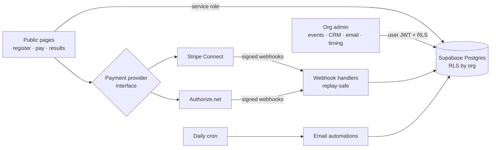

# EventHaven

**Event registration, payments and a contact CRM, in production at [eventhaven.app](https://eventhaven.app).**

EventHaven is a multi-tenant platform that runs real events end to end. That covers
public registration pages with custom fields, ticket tiers and promo codes; paid
registration through Stripe Connect or Authorize.net; deposit and balance payment plans;
automated reminder emails; a contact CRM with tags and CSV import/export; and, on race
day, check-in, bib assignment, live phone-based race timing and public results.

It's my own product: I designed, built and run it. It's in production for my own
events and hasn't been launched to outside organizations yet. It ran paid registration, check-in and results for a community 5K in August 2026.

*The source is private because the database holds real registrants' data. This repo is the
case study, with excerpts published from the real code.*

---

## Stack

Next.js 16 (App Router, `proxy.ts`) · React 19 · TypeScript · Tailwind 4 · shadcn ·
Tiptap · Supabase (Postgres, Auth, RLS) · Stripe Connect Express · Authorize.net
(Accept.js) · Resend / Brevo · Vercel (hosting and cron)

**Multi-tenancy in the database, not just the app.** A custom Supabase access-token hook
puts the active org into the JWT. Row-level security is scoped by `current_org_id()`, and
one user can belong to several orgs. Every member can read; only owners and admins can
write. Public pages never use the anon key on tenant tables. They read through the service
role, on purpose.

## The bugs that mattered

Nearly every hard problem here was about money or about data leaking between tenants.
Each is written as problem → cause → fix.

1. **A duplicate paid registration took the money but gave no seat.** Checkout ran
   *before* the duplicate check, and the webhook ignored the "already registered" result.
   **Fix:** check before Checkout. If a duplicate still gets through, refund it
   automatically.

2. **Stripe sending the same webhook twice refunded a paying registrant.** A redelivered
   `checkout.session.completed` looked like a duplicate registration. **Fix:** payments
   that already have a registration are recognized as replays, and there's a re-check
   before any refund so two concurrent deliveries can't refund each other.

3. **Two people could both pass a capacity check**, and for paid events the gap between
   check and write was *minutes*, not milliseconds, because the check ran at checkout and
   the insert ran in the webhook. **Fix:** a claim ledger, and one Postgres function that
   counts and inserts while holding a transaction-scoped advisory lock, so the check and
   the write can't be separated. A unique constraint doubles as the webhook-replay guard.
   → [`excerpts/atomic_resource_claims.sql`](excerpts/atomic_resource_claims.sql)

4. **Any signed-in user could read every org's registration answers.** Postgres OR's
   permissive policies together, and one of them had no org scope. **Fix:** I rewrote the
   policy and verified it by impersonating another org's owner. That audit also closed
   anonymous listing of events and an invite table readable without login.

5. **Stripe Connect fee splits drove the platform balance negative.** The destination
   charge transferred the gross amount to the organizer, so processing costs came out of
   the platform. **Fix:** the application fee now covers processing.

Smaller ones worth a line:
- the auth proxy redirected the reminder cron to `/login`, so reminders silently never sent
- a user in two orgs was locked out because a lookup expected exactly one row
- Authorize.net's test mode returns transaction id `"0"`, which a truthiness check treated as a failed payment

## Two payment processors, one honest interface

Stripe Checkout redirects away and finishes asynchronously through a webhook. Authorize.net
tokenizes the card in the browser and charges on the server within the same request. The
provider interface keeps that difference visible instead of flattening it: `beginCheckout`
returns either `redirect` or `completed`. The synchronous path is better for anything with
limited capacity, because the registrant is still there to be told the tier just closed.
Account onboarding is left out of the interface on purpose, because the two processors share
no real shape there. → [`excerpts/payment_provider.ts`](excerpts/payment_provider.ts)

## Testing

- **Database tests run against a throwaway Postgres.** The runner applies every migration
  *twice* to prove they're idempotent. It then checks RLS, seat claims, capacity changes and
  live timing: 61 assertions, covering rows a role must *not* be able to see.
- **Unit tests** cover the payment-plan math, including DST and timezone edge cases
  (14/14 passing).

## By the numbers

| | |
|---|---|
| Code | ~16.4k lines TSX · ~8.2k TS · ~2k SQL |
| Surface | 38 pages, 14 API route handlers |
| Database | 34 migrations, 16 Postgres functions |
| History | 115 commits, May–November 2026 |

---

*Built by [Aniken Nielson](https://github.com/havenlabs-dev) under HavenLabs.*
